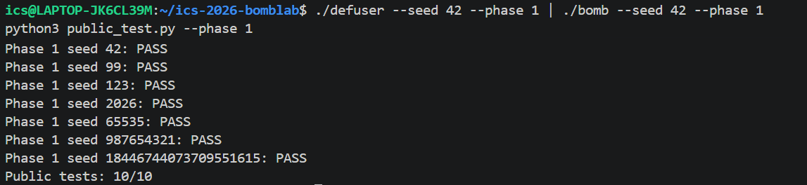
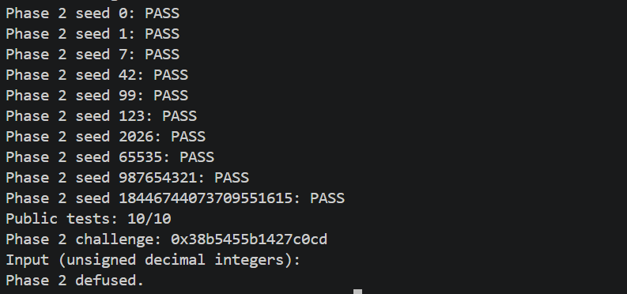
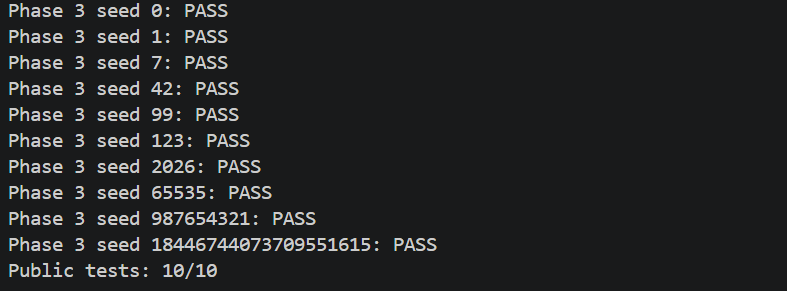
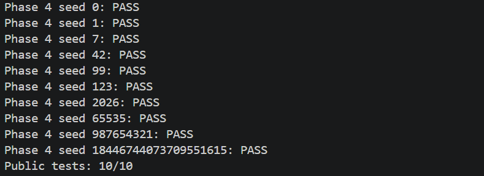
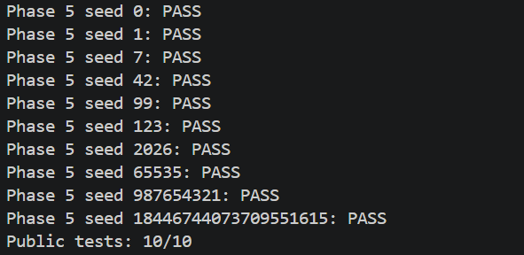
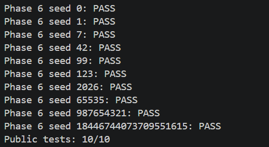
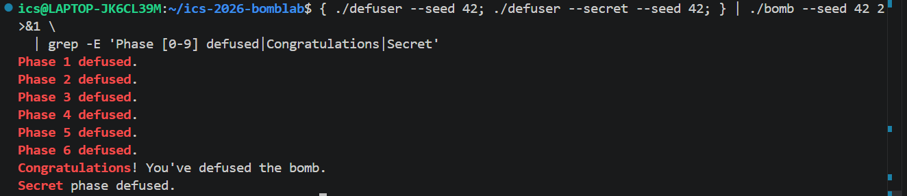

# 计算机系统基础 Lab2：BombLab 实验报告

- 姓名：李元轲
- 学号：25800190120
- 仓库：<https://github.com/K-syc/ics-2026-bomblab>

---

## 0. 实验环境

| 项目 | 内容 |
| --- | --- |
| 系统 | Ubuntu 24.04 on WSL2，内核 6.18.54.1-microsoft-standard-WSL2 |
| 架构 | `uname -sm` → `Linux x86_64` |
| 工具链 | gcc 13.3.0、gdb 15.1、GNU Make 4.3、binutils 2.42（`objdump`/`ld`）、python3 3.12.3 |
| 炸弹 | 由 `make bomb` 领取的个人炸弹（package `28e0091e2acaaa3ea6e7d157`） |

分析方法：先用 `objdump -d --no-show-raw-insn --disassemble=<函数>` 离线导出汇编，在编辑器中标注；
再用 `gdb` 在关键 `cmp` 前下断点，用 `p/u $eax`、`x/1uw $rbp-0x14` 核对从汇编读出的计算关系。
调试时不做任何 `set` 修改，仅观察原程序的运行行为。

---

## 1. 第 1 关：函数调用、参数传递、返回值

### 1.1 入口与输入格式

`phase_01` 的入口处，按 x86-64 调用约定：`%rdi` 指向口令字符串，`%rsi` 是 challenge。

```asm
402090 <phase_01>:
  402090: endbr64
  402094: push   %rbp
  402095: mov    %rsp,%rbp
  402098: push   %r12
  40209a: mov    %rsi,%r12          # r12 = challenge
  40209d: mov    $0x1,%esi          # 第 2 个参数 = 1
  4020a2: push   %rbx
  4020a3: mov    %rdi,%rbx          # rbx = 输入字符串
  4020a6: sub    $0x10,%rsp
  4020aa: call   402c70 <valid_u32_fields>
  4020af: test   %al,%al
  4020b1: jne    4020c0 <phase_01+0x30>
  4020b3: add    $0x10,%rsp
  4020b7: xor    %eax,%eax          # 格式不合法 → 返回 0
  ...
```

`valid_u32_fields(input, 1)` 检查输入是否为**恰好 1 个**合法无符号 32 位十进制整数，
所以本关口令只含 1 个整数。

随后用 `sscanf` 把该整数解析到栈上的 4 字节局部变量：

```asm
  4020c0: xor    %eax,%eax
  4020c2: lea    -0x14(%rbp),%rdx   # 解析结果写入 -0x14(%rbp)
  4020c6: mov    $0x403189,%esi     # 格式串（"%u"）
  4020cb: mov    %rbx,%rdi
  4020ce: call   4011e0 <__isoc99_sscanf@plt>
  4020d3: cmp    $0x1,%eax          # 必须成功解析 1 项
  4020d6: jne    4020b3 <phase_01+0x23>
  4020d8: mov    %r12,%rdi          # rdi = challenge
  4020db: call   402050 <p1_compute>
  4020e0: cmp    %eax,-0x14(%rbp)   # 输入值 vs p1_compute(challenge)
  4020e3: sete   %al                # 相等返回 1
  4020e6: add    $0x10,%rsp
  4020ea: pop    %rbx
  4020eb: pop    %r12
  4020ed: pop    %rbp
  4020ee: ret
```

结论：**口令 = `p1_compute(challenge)` 的低 32 位值**。比较双方都是 32 位（`%eax` 与
`-0x14(%rbp)` 的 4 字节），因此整个计算按模 2³² 回绕。

### 1.2 `p1_compute` 的调用编排

`p1_compute` 本身没有算术，只负责切分 challenge 并串联三个 `p1_step*`：

```asm
402050 <p1_compute>:
  402054: push   %rbp
  402055: mov    %rdi,%rax
  402058: mov    %rdi,%rdx
  40205b: mov    %edi,%esi          # esi = challenge 低 32 位
  40205d: shr    $0x20,%rax         # rax = challenge >> 32
  402061: mov    %edi,%r8d          # r8d = challenge 低 32 位（备份）
  402064: shr    $0x10,%rdx         # rdx = challenge >> 16（64 位移位）
  402068: mov    %eax,%edi          # edi = challenge 高 32 位
  40206a: mov    %rsp,%rbp
  40206d: call   402040 <p1_step2>
  402072: mov    %rdx,%rsi          # rsi = challenge >> 16
  402075: mov    %r8d,%edi          # edi = challenge 低 32 位
  402078: mov    %eax,%ecx          # ecx 保存 step2 结果
  40207a: call   402020 <p1_step0>
  40207f: mov    %ecx,%esi          # esi = step2 结果
  402081: mov    %eax,%edi          # edi = step0 结果
  402083: call   402030 <p1_step1>
  402088: pop    %rbp
  402089: ret
```

记 `L = challenge 低 32 位`、`H = challenge 高 32 位`，则数据流为：

```
A = p1_step2(H, L)
B = p1_step0(L, challenge >> 16)
结果 = p1_step1(B, A)
```

两个细节：

- `p1_step2` 的第二个参数来自 `0x40205b` 的 `mov %edi,%esi`，也就是 **L**，不是空值；
- `0x402072` 的 `mov %rdx,%rsi` 在 `call p1_step2` **之后**。查 `p1_step2` 的代码可知它只使用
  `%edi/%esi/%eax`，未改写 `%rdx`，因此这里读到的仍是 `0x402064` 算出的 `challenge >> 16`
  （64 位结果，高半部分也会参与运算）。

### 1.3 三个 step 函数

```asm
402020 <p1_step0>:
  402024: lea    (%rdi,%rsi,8),%eax   # eax = a + 8b（64 位相加后截断到 32 位）
  402027: xor    $0xde98,%eax
  40202c: ret

402030 <p1_step1>:
  402034: xor    $0x64ae,%esi         # esi = y ^ 0x64ae
  40203a: lea    (%rsi,%rdi,2),%eax   # eax = (y^0x64ae) + 2x
  40203d: ret

402040 <p1_step2>:
  402044: sub    %esi,%edi            # edi = H - L
  402046: lea    0xc922(%rdi,%rdi,2),%eax  # eax = 3*edi + 0xc922
  40204d: ret
```

对应关系：

| 函数 | 汇编 | 表达式 |
| --- | --- | --- |
| `p1_step0(a,b)` | `lea (%rdi,%rsi,8)` + `xor $0xde98` | `(a + 8b) ^ 0xde98` |
| `p1_step1(x,y)` | `xor $0x64ae,%esi` + `lea (%rsi,%rdi,2)` | `(y ^ 0x64ae) + 2x` |
| `p1_step2(x,y)` | `sub %esi,%edi` + `lea 0xc922(%rdi,%rdi,2)` | `3(x − y) + 0xc922` |

### 1.4 恢复出的计算关系

设 `L = (uint32_t)challenge`、`H = (uint32_t)(challenge >> 32)`：

```
A    = 3 * (H − L) + 0xc922                  （32 位回绕）
B    = (L + 8 * (challenge >> 16)) ^ 0xde98
口令 = (A ^ 0x64ae) + 2 * B                   （32 位回绕）
```

对应的求解实现（`defuser.c` 中的 `solve_phase_1`）：

```c
int solve_phase_1(uint64_t challenge, char *out, size_t cap) {
    uint32_t values[MAX_FIELDS] = {0};
    size_t count = 0;

    uint32_t low  = (uint32_t)challenge;
    uint32_t high = (uint32_t)(challenge >> 32);

    /* p1_step2: 3 * (H - L) + 0xc922 */
    uint32_t a = (uint32_t)((high - low) * 3u + 0xc922u);

    /* p1_step0: (L + 8 * (challenge >> 16)) ^ 0xde98 */
    uint32_t b = (uint32_t)(low + 8ull * (challenge >> 16)) ^ 0xde98u;

    /* p1_step1: (A ^ 0x64ae) + 2 * B */
    values[0] = (uint32_t)((a ^ 0x64aeu) + 2u * b);

    count = 1;   /* 本关只需 1 个整数 */
    return write_answer(out, cap, values, count);
}
```

运算宽度上的三个注意点：

1. `(high - low)` 用 `uint32_t` 计算，减法按 2³² 自然回绕，不能用有符号 `int`；
2. `8ull * (challenge >> 16)` 必须是 64 位移位与乘法，因为 `challenge >> 16` 仍保留原始高位；
3. `xor $0xde98` 发生在 `lea` 之后，异或与加法的顺序不能反。

### 1.5 验证

```bash
make
./defuser --seed 42 --phase 1 | ./bomb --seed 42 --phase 1
python3 public_test.py --phase 1
```

| 检查项 | 命令 / seed | 实测结果 |
| --- | --- | --- |
| 单关通过 | seed 42，phase 1 | `Phase 1 defused.`（challenge `0x28efe333b266f103`，求解值 `4221874290`） |
| 公开测试 | `public_test.py --phase 1` | `Public tests: 10/10`（seed 0/1/7/42/99/123/2026/65535/987654321/18446744073709551615 全部 PASS） |
| 非公开 seed | seed 43 | `Phase 1 defused.`（challenge `0x9cde98852e60034b`） |
| 非公开 seed | seed 777 | `Phase 1 defused.`（challenge `0xa710687caae04440`） |

在公开列表之外另取 seed 43 与 777 复验，两次都通过，说明求解函数对 challenge 的任意取值成立，
不是针对公开 seed 写死的答案表。




### 1.6 小结

本关是最小规模的“函数调用 + 参数传递 + 返回值”模型：`phase_01` 只做输入校验和一次比较，
真正的计算被拆到 `p1_compute` 与三个 `p1_step*` 中。关键点在于识别调用约定（`%rdi/%rsi` 的
含义在每次 `call` 前都要重新判断），以及 32 位运算的回绕语义——`p1_compute` 的返回值是
`%eax`，与输入比较时也只比较低 32 位，所以推导过程中所有中间值都要按模 2³² 处理。

---

## 2. 第 2 关：数组、循环、递推关系

### 2.1 输入格式：6 个整数，后两个参数走栈

```asm
4020f0 <phase_02>:
  4020fa: mov    %rsi,%r13          # r13 = challenge
  4020fd: mov    $0x6,%esi          # 第 2 个参数 = 6
  402104: mov    %rdi,%r12          # r12 = 输入字符串
  40210c: call   402c70 <valid_u32_fields>
  ...
  40212a: lea    -0x2c(%rbp),%rax
  40212e: lea    -0x3c(%rbp),%rcx
  402132: mov    $0x40317a,%esi     # 格式串
  402137: push   %rax               # 第 7 个参数 → 栈
  402138: lea    -0x30(%rbp),%rax
  40213c: lea    -0x40(%rbp),%rdx   # &a[0]
  402140: mov    %r12,%rdi
  402143: push   %rax               # 第 6 个参数 → 栈
  402144: lea    -0x34(%rbp),%r9    # &a[3]
  402148: lea    -0x38(%rbp),%r8    # &a[2]
  40214c: xor    %eax,%eax
  40214e: call   4011e0 <__isoc99_sscanf@plt>
  402153: pop    %rdx
  402154: pop    %rcx
  402155: cmp    $0x6,%eax          # 必须成功解析 6 项
  402158: jne    402115 <phase_02+0x25>
```

`valid_u32_fields(input, 6)` 限定 6 个 u32 字段。`sscanf` 的变参前 4 个仍走
`%rdx/%rcx/%r8/%r9`，第 5、6 个必须压栈，所以出现了两条 `push`。六个输出地址依次是
`-0x40, -0x3c, -0x38, -0x34, -0x30, -0x2c`，间隔 4 字节，即一个 `uint32_t a[6]`。

### 2.2 `a[0]`：取自 challenge 的最高 4 位

```asm
  40215a: mov    %r13,%rax
  40215d: mov    -0x40(%rbp),%esi   # esi = a[0]
  402160: shr    $0x2e,%rax         # challenge >> 46
  402164: and    $0xf,%eax          # 取低 4 位，即 challenge 的 bit46-49
  402167: xor    $0x7,%eax
  40216a: cmp    %eax,%esi
  40216c: jne    402115 <phase_02+0x25>
```

`a[0] = ((challenge >> 46) & 0xf) ^ 7`

### 2.3 `a[1..5]`：递推循环

```asm
  40216e: mov    $0x1,%edx                 # i = 1
  402173: lea    0xc(%rdx),%ecx            # ecx = i + 12
  402176: mov    %r13,%rax
  402179: shr    %cl,%rax                  # challenge >> (i+12)
  40217c: lea    (%rsi,%rsi,4),%ecx        # ecx = 5 * a[i-1]  ← rsi 此时仍是上一轮的值
  40217f: mov    -0x40(%rbp,%rdx,4),%esi   # esi = a[i]
  402183: and    $0x3f,%eax                # & 0x3f
  402186: sub    %edx,%ecx                 # ecx = 5*a[i-1] - i
  402188: add    $0x3,%eax                 # + 3
  40218b: xor    %ecx,%eax
  40218d: cmp    %eax,%esi                 # 与 a[i] 比较
  40218f: jne    402115 <phase_02+0x25>
  402191: add    $0x1,%rdx                 # i++
  402195: cmp    $0x6,%rdx
  402199: jne    402173 <phase_02+0x83>
```

关键细节：`0x40217c` 用 `%rsi` 计算 `5*a[i-1]`，而 `%rsi` 要等到 `0x40217f` 才被 `a[i]` 覆盖，
所以这里用的是**上一轮**的值；若把顺序看反，递推就会用错起点。

全部运算都是 32 位（`add`/`sub`/`xor`/`cmp` 都作用于 `%eax`/`%ecx`/`%esi`），故按模 2³² 回绕。

### 2.4 恢复出的计算关系

```
a[0] = ((challenge >> 46) & 0xf) ^ 7
a[i] = (((challenge >> (i+12)) & 0x3f) + 3) ^ (5 * a[i-1] - i)      i = 1..5
```

对应实现（`defuser.c` 中的 `solve_phase_2`）：

```c
int solve_phase_2(uint64_t challenge, char *out, size_t cap) {
    uint32_t values[MAX_FIELDS] = {0};
    size_t count = 0;

    /* a[0]: challenge 的最高 4 位 */
    values[0] = (uint32_t)((challenge >> 46) & 0xfu) ^ 0x7u;

    /* a[i] = (((challenge >> (i+12)) & 0x3f) + 3) ^ (5*a[i-1] - i) */
    for (uint32_t i = 1; i < 6; ++i) {
        uint32_t t    = (uint32_t)((challenge >> (i + 12u)) & 0x3fu) + 3u;
        uint32_t prev = 5u * values[i - 1] - i;      /* uint32_t 自动按模 2^32 回绕 */
        values[i] = t ^ prev;
    }

    count = 6;   /* 本关需要 6 个整数 */
    return write_answer(out, cap, values, count);
}
```

三个注意点：

1. `values` 是 `uint32_t`，`5u * values[i-1] - i` 自然回绕，不能改用 `long` 或 `int64_t`；
2. 移位量是 `i + 12`（即 13…17），不是 `i`，也不是 32 的倍数；
3. `a[0]` 用 `>> 46` 且先 `& 0xf` 再 `^ 7`，与 `a[i]` 的 `& 0x3f` 不是同一个掩码。

### 2.5 验证

```bash
make
./defuser --seed 42 --phase 2 | ./bomb --seed 42 --phase 2
python3 public_test.py --phase 2
./defuser --seed 777 --phase 2 | ./bomb --seed 777 --phase 2
./defuser --seed 515 --phase 2 | ./bomb --seed 515 --phase 2
```

| 检查项 | 命令 / seed | 实测结果 |
| --- | --- | --- |
| 单关通过 | seed 42，phase 2 | 口令 `14 122 545 2688 13422 67115`，`Phase 2 defused.`（challenge `0x47526757130f9f52`） |
| 公开测试 | `public_test.py --phase 2` | `Public tests: 10/10` |
| 非公开 seed | seed 777 | `Phase 2 defused.`（challenge `0x4fd675fd151af7f4`） |
| 非公开 seed | seed 515 | `Phase 2 defused.`（challenge `0x38b5455b1427c0cd`） |




### 2.6 小结

本关把 challenge 切成 6 段：`a[0]` 取最高的 4 位（`>>46`），`a[1..5]` 依次取
`bit(12+i)…bit(17+i)` 的 6 位片段（`>>(i+12)` 后 `&0x3f`）。每一段还要与上一段的线性组合
`5*a[i-1] - i` 异或，从而形成前后依赖的递推链——这正是「同一天的几次校时写在不同的位置，
每次接着上一次的结果」的含义。读这类循环时要特别注意「先算旧值、再载入新值」的指令顺序，
以及循环上界（`i` 从 1 到 5，共 5 次迭代）。

## 3. 第 3 关：switch 分支与跳转表

### 3.1 输入格式：2 个整数

```asm
4022a0 <phase_03>:
  4022ad: mov    $0x2,%esi          # 恰好 2 个 u32 字段
  4022ba: call   402c70 <valid_u32_fields>
  ...
  4022d0: xor    %eax,%eax
  4022d2: lea    -0x14(%rbp),%rcx   # &a[1]
  4022d6: lea    -0x18(%rbp),%rdx   # &a[0]
  4022da: mov    $0x403186,%esi
  4022df: mov    %rbx,%rdi
  4022e2: call   4011e0 <__isoc99_sscanf@plt>
  4022e7: cmp    $0x2,%eax          # 必须解析出 2 项
  4022ea: jne    4022c3 <phase_03+0x23>
```

### 3.2 第 1 个数：challenge 的低 3 位

```asm
  4022ec: mov    %r12d,%edi         # 低 32 位
  4022f1: and    $0x7,%edi
  4022f4: cmp    %edi,-0x18(%rbp)   # 与 a[0] 比较
  4022f7: jne    4022c5 <phase_03+0x25>
```

`a[0] = challenge & 7`

### 3.3 第 2 个数：两个参数与两级间接跳转

```asm
  4022f9: mov    %r12,%rax
  4022fc: mov    %r12,%rsi
  4022ff: shr    $0x3,%rax          # challenge >> 3
  402303: shr    $0x20,%rsi         # challenge >> 32
  402307: xor    %eax,%esi          # esi = (challenge>>32) ^ ((challenge>>3) 低 32 位)
  402309: call   402240 <p3_dispatch>
  40230e: cmp    %eax,-0x14(%rbp)   # 与 a[1] 比较
  402311: sete   %al
```

调用前 `%edi` 仍是 `0x4022ec` 设置的 `challenge & 7`，因此 `p3_dispatch` 收到两个参数：

```asm
402240 <p3_dispatch>:
  402244: mov    %edi,%eax          # 第 1 个参数 → switch 选择子
  402246: mov    %esi,%edi          # 第 2 个参数 → 转交给具体 case
  402248: cmp    $0x7,%eax
  40224b: ja     402295             # 越界 → 返回 0
  40224d: notrack jmp *0x405820(,%rax,8)   # 8 项跳转表，每项 8 字节
  402295: xor    %eax,%eax
  402297: ret
```

记 `sel = challenge & 7`、`x = (uint32_t)(challenge >> 32) ^ (uint32_t)(challenge >> 3)`，
则 `a[1] = p3_case[sel](x)`。注意选择子与 `a[0]` 是同一个值——第 1 个输入决定第 2 个输入走哪条分支。

`notrack` 与各 `case` 开头的 `endbr64` 是 CET（控制流完整性）相关的标记，不影响计算结果。

### 3.4 跳转表还原

用 `gdb -batch -ex 'x/8gx 0x405820' ./bomb` 读出表的 8 个表项，发现它们指向的是
`0x402258`–`0x402290` 之间的**中转跳板**，每个跳板再 `jmp` 到真正的 `p3_case_*`：

| 选择子 | 表项 | 跳板指令 | 实际分支 | 公式 |
| --- | --- | --- | --- | --- |
| 0 | `0x402268` | `jmp p3_case_5` | case_5 | `2x ^ 0x7bcf` |
| 1 | `0x402270` | `jmp p3_case_4` | case_4 | `5x + 0x3ca5` |
| 2 | `0x402278` | `jmp p3_case_6` | case_6 | `(x ^ 0x7cf1) + (x>>2)` |
| 3 | `0x402280` | `jmp p3_case_0` | case_0 | `(x ^ 0xf74f) + (x>>2)` |
| 4 | `0x402288` | `jmp p3_case_7` | case_7 | `3x + 0xc406` |
| 5 | `0x402290` | `jmp p3_case_3` | case_3 | `3x + 0xef96` |
| 6 | `0x402258` | `jmp p3_case_2` | case_2 | `2x ^ 0xf600` |
| 7 | `0x402260` | `jmp p3_case_1` | case_1 | `5x + 0x0f` |

映射是**打乱**的（0→case_5、1→case_4、2→case_6……），不能按 `p3_case_0..7` 的编号顺序硬套——
符号名里的数字不代表分支顺序，只有跳转表的排列才是程序真实的顺序。

各分支的汇编：

```asm
4021a0 <p3_case_0>:  mov %edi,%eax ; shr $0x2,%edi ; xor $0xf74f,%eax ; add %edi,%eax
4021c0 <p3_case_1>:  lea 0xf(%rdi,%rdi,4),%eax
4021d0 <p3_case_2>:  lea (%rdi,%rdi,1),%eax ; xor $0xf6,%ah
4021e0 <p3_case_3>:  lea 0xef96(%rdi,%rdi,2),%eax
4021f0 <p3_case_4>:  lea 0x3ca5(%rdi,%rdi,4),%eax
402200 <p3_case_5>:  lea (%rdi,%rdi,1),%eax ; xor $0x7bcf,%eax
402210 <p3_case_6>:  mov %edi,%eax ; shr $0x2,%edi ; xor $0x7cf1,%eax ; add %edi,%eax
402230 <p3_case_7>:  lea 0xc406(%rdi,%rdi,2),%eax
```

其中的两个陷阱：

1. `p3_case_2` 的 `xor $0xf6,%ah` 作用于 `%ah`，即 **bit8~15**，等价于 `^ 0x0000f600`，
   不是 `^ 0xf6`；
2. `p3_case_0/6` 先用 `shr $0x2,%edi` 备份 `x>>2`，再 `xor` 原值、最后 `add`，
   所以是 `(x ^ c) + (x>>2)`，而不是 `(x + (x>>2)) ^ c`。

### 3.5 恢复出的计算关系

```
sel  = challenge & 7
x    = (uint32_t)(challenge >> 32) ^ (uint32_t)(challenge >> 3)
a[0] = sel
a[1] = case_table[sel](x)     # 按 3.4 的映射
```

对应实现（`defuser.c` 中的 `solve_phase_3`）：

```c
int solve_phase_3(uint64_t challenge, char *out, size_t cap) {
    uint32_t values[MAX_FIELDS] = {0};

    uint32_t sel = (uint32_t)challenge & 0x7u;
    uint32_t x   = (uint32_t)(challenge >> 32) ^ (uint32_t)(challenge >> 3);

    uint32_t y;
    switch (sel) {
    case 0: y = (2u * x) ^ 0x7bcfu;        break;  /* 跳板 0x402268 → p3_case_5 */
    case 1: y = 5u * x + 0x3ca5u;          break;  /* 0x402270 → p3_case_4 */
    case 2: y = (x ^ 0x7cf1u) + (x >> 2);  break;  /* 0x402278 → p3_case_6 */
    case 3: y = (x ^ 0xf74fu) + (x >> 2);  break;  /* 0x402280 → p3_case_0 */
    case 4: y = 3u * x + 0xc406u;          break;  /* 0x402288 → p3_case_7 */
    case 5: y = 3u * x + 0xef96u;          break;  /* 0x402290 → p3_case_3 */
    case 6: y = (2u * x) ^ 0xf600u;        break;  /* 0x402258 → p3_case_2 */
    case 7: y = 5u * x + 0x0fu;            break;  /* 0x402260 → p3_case_1 */
    default: return 1;
    }

    values[0] = sel;
    values[1] = y;
    return write_answer(out, cap, values, 2);
}
```

### 3.6 验证

```bash
make
./defuser --seed 42 --phase 3 | ./bomb --seed 42 --phase 3
python3 public_test.py --phase 3
./defuser --seed 888 --phase 3 | ./bomb --seed 888 --phase 3
./defuser --seed 2024 --phase 3 | ./bomb --seed 2024 --phase 3
```

| 检查项 | 命令 / seed | 实测结果 |
| --- | --- | --- |
| 单关通过 | seed 42，phase 3 | 口令 `4 763493549`，`Phase 3 defused.`（challenge `0x581ce1ff0e4ae394`） |
| 公开测试 | `public_test.py --phase 3` | `Public tests: 10/10` |
| 非公开 seed | seed 888 | `Phase 3 defused.`（challenge `0x9da7b27d1fd6b456`） |
| 非公开 seed | seed 2024 | `Phase 3 defused.`（challenge `0x1dbe69e0ae9bb859`） |




### 3.7 小结

本关的 `switch` 编译成了一张位于 `0x405820` 的 8 项绝对地址跳转表，表项先落到
`0x402258`–`0x402290` 的中转跳板，再跳到具体的 `p3_case_*`。还原的关键不是猜分支顺序，
而是**把表读出来**：`p3_case_N` 的符号编号与实际的选择子顺序完全不一致（0 对应 case_5），
按编号顺序硬写会全错。此外 `xor $0xf6,%ah` 这类只作用于高 8 位的指令，以及
`shr`/`xor`/`add` 的先后次序，都是这类题最常见的失分点。

## 4. 第 4 关：递归调用与返回过程

### 4.1 输入格式：1 个整数，但调用点传了 4 个参数

```asm
402390 <phase_04>:
  40239d: mov    $0x1,%esi          # 1 个 u32 字段
  4023aa: call   402c70 <valid_u32_fields>
  ...
  4023c0: xor    %eax,%eax
  4023c2: lea    -0x14(%rbp),%rdx
  4023c6: mov    $0x403189,%esi
  4023cb: mov    %rbx,%rdi
  4023ce: call   4011e0 <__isoc99_sscanf@plt>
  4023d3: cmp    $0x1,%eax
  4023d6: jne    4023b3 <phase_04+0x23>
```

注意：口令只有 1 个整数，但紧接着调用的 `p4_walk` 接收 4 个参数——

```asm
  4023d8: mov    %r12,%rcx
  4023db: mov    %r12,%rax
  4023de: mov    %r12d,%edi
  4023e1: xor    %esi,%esi          # esi = 0
  4023e3: shr    $0x20,%rax         # rax = challenge >> 32
  4023e7: shr    $0x7,%rcx          # rcx = challenge >> 7
  4023eb: and    $0x7f,%edi         # edi = challenge & 0x7f
  4023ee: mov    $0x7f,%edx         # edx = 0x7f
  4023f3: xor    %eax,%ecx          # ecx = (challenge>>7) ^ (challenge>>32)，32 位
  4023f5: call   402320 <p4_walk>
  4023fa: cmp    %eax,-0x14(%rbp)   # 与唯一的一个输入比较
  4023fd: sete   %al
```

| 寄存器 | 形参 | 值 |
| --- | --- | --- |
| `%rdi` | `target` | `challenge & 0x7f` |
| `%rsi` | `lo` | `0` |
| `%rdx` | `hi` | `0x7f` |
| `%rcx` | `key` | `(uint32_t)(challenge >> 7) ^ (uint32_t)(challenge >> 32)` |

于是 `a[0] = p4_walk(challenge & 0x7f, 0, 0x7f, key)`。参数个数和输入个数不一致，
是这一关第一个容易误判的地方。

### 4.2 `p4_walk`：二分查找 + 回溯归并

`p4_walk` 的核心形状是「算中点 → 命中就返回 → 否则递归另一半 → 用返回值再算」。

**① 求中点并判断命中**

```asm
402324: mov    %edi,%eax          # eax = target
402326: mov    %edx,%edi
402328: sub    %esi,%edi          # hi - lo
40232a: shr    $1,%edi            # (hi - lo) / 2
40232c: add    %esi,%edi          # mid = lo + (hi - lo)/2
40232e: cmp    %eax,%edi
402330: je     402380             # mid == target → 命中，跳出递归
```

**② base case（`0x402380`）**

```asm
402380: lea    0x9e(%rdi),%eax    # mid + 0x9e
402386: xor    %ecx,%eax          # ^ key
402388: ret
```

**③ 未命中：择半边递归，回溯时归并**

```asm
402337: lea    (%rdi,%rcx,1),%ebx # mix = mid + key（先备份，后面要用）
40233e: cmp    %edi,%eax
402340: jb     402360             # target < mid → 左半区
; ---- target > mid ----
402342: lea    0x1(%rdi),%esi     # lo = mid + 1
402347: call   402320 <p4_walk>
40234c: lea    (%rax,%rax,2),%eax # 3 * 返回值
40234f: xor    %ebx,%eax          # ^ mix
402356: xor    $0x1e,%eax         # ^ 0x1e
402359: ret
; ---- target < mid ----
402360: lea    -0x1(%rdi),%edx    # hi = mid - 1
402365: call   402320 <p4_walk>
40236a: lea    (%rax,%rax,2),%eax # 3 * 返回值
40236d: xor    %ebx,%eax          # ^ mix
402374: xor    $0x1c,%eax         # ^ 0x1c
402377: ret
```

两条路径只差三处：新区间是 `lo = mid+1` 还是 `hi = mid-1`、末尾异或 `0x1e` 还是 `0x1c`、
以及 `jb` 的方向。`cmp %edi,%eax` + `jb` 判断的是 `%eax < %edi`，即 **`target < mid`** 时
跳到 `0x402360`（左半区、`^ 0x1c`）；反之走 `0x402342`（右半区、`^ 0x1e`）。

### 4.3 恢复出的递推关系

```
walk(target, lo, hi, key):
    mid = lo + (hi - lo) / 2
    if mid == target:
        return (mid + 0x9e) ^ key
    mix = mid + key
    if target < mid:
        return (3 * walk(target, lo, mid-1, key)) ^ mix ^ 0x1c
    else:
        return (3 * walk(target, mid+1, hi, key)) ^ mix ^ 0x1e
```

初始 `lo = 0`、`hi = 0x7f`，而 `target = challenge & 0x7f` 一定落在 `[0, 0x7f]` 内，
因此二分必然命中 base case，不会出现 `lo > hi`；区间长度 128，递归深度最多 7 层，不存在栈溢出。

对应实现（`defuser.c` 中的辅助函数与 `solve_phase_4`）：

```c
/* 第 4 关：二分查找 + 回溯归并，对应 p4_walk */
static uint32_t p4_walk(uint32_t target, uint32_t lo, uint32_t hi, uint32_t key) {
    uint32_t mid = lo + (hi - lo) / 2u;

    if (mid == target)
        return (mid + 0x9eu) ^ key;          /* base case */

    uint32_t mix = mid + key;
    if (target < mid) {
        uint32_t r = p4_walk(target, lo, mid - 1u, key);
        return (3u * r) ^ mix ^ 0x1cu;       /* 左半区 */
    }
    uint32_t r = p4_walk(target, mid + 1u, hi, key);
    return (3u * r) ^ mix ^ 0x1eu;           /* 右半区 */
}

int solve_phase_4(uint64_t challenge, char *out, size_t cap) {
    uint32_t values[MAX_FIELDS] = {0};

    uint32_t target = (uint32_t)challenge & 0x7fu;
    uint32_t key    = (uint32_t)(challenge >> 32) ^ (uint32_t)(challenge >> 7);

    values[0] = p4_walk(target, 0u, 0x7fu, key);

    size_t count = 1;
    return write_answer(out, cap, values, count);
}
```

两个易错点：

1. `jb` 的方向：`cmp %edi,%eax` 比较的是 `target` 与 `mid`，左分支末尾是 `^ 0x1c`、
   右分支是 `^ 0x1e`，两个常量对调就会全错；
2. `lea (%rax,%rax,2),%eax` 是 `3 * rax`（`rax + 2*rax`），不是 `2 * rax`。

### 4.4 验证

```bash
make
./defuser --seed 42 --phase 4 | ./bomb --seed 42 --phase 4
python3 public_test.py --phase 4
./defuser --seed 4242 --phase 4 | ./bomb --seed 4242 --phase 4
./defuser --seed 31337 --phase 4 | ./bomb --seed 31337 --phase 4
```

| 检查项 | 命令 / seed | 实测结果 |
| --- | --- | --- |
| 单关通过 | seed 42，phase 4 | 口令 `1439493451`，`Phase 4 defused.`（challenge `0x09bc585a244823f2`） |
| 公开测试 | `public_test.py --phase 4` | `Public tests: 10/10` |
| 非公开 seed | seed 4242 | `Phase 4 defused.`（challenge `0x356ba00bf5526eb4`） |
| 非公开 seed | seed 31337 | `Phase 4 defused.`（challenge `0xcf3acbb0e7ed57fb`） |




### 4.5 小结

本关的递归不是「层层展开的深度优先搜索」，而是一棵**隐式的二分查找树**：每一层用
`mid = lo + (hi-lo)/2` 把区间对半切，比较 `target` 与 `mid` 决定走哪边，命中时用
`(mid + 0x9e) ^ key` 作为叶子值，回溯时每层做 `3 * r ^ (mid + key) ^ {0x1c | 0x1e}`。
还原这类函数的关键是分清「递推参数怎么变」（这里变的是 `lo`/`hi`，不是常见的 `n-1`）
和「回溯时如何合成」（乘 3、异或中点混淆值、再异或一个方向常量）。由于区间长度固定为
128，递归深度有确定上界，可以放心用递归实现。


## 5. 第 5 关：结构体布局、指针、链表遍历

### 5.1 输入格式：2 个整数，一个来自返回值、一个来自指针回写

```asm
402480 <phase_05>:
  40248d: mov    $0x2,%esi          # 2 个 u32 字段
  40249a: call   402c70 <valid_u32_fields>
  ...
  4024b2: lea    -0x18(%rbp),%rcx   # &a[1]
  4024b6: lea    -0x1c(%rbp),%rdx   # &a[0]
  4024c2: call   4011e0 <__isoc99_sscanf@plt>
  4024c7: cmp    $0x2,%eax
  4024ca: jne    4024a3 <phase_05+0x23>
  4024cc: lea    -0x14(%rbp),%rsi   # 第 2 个参数：输出缓冲区
  4024d0: mov    %r12,%rdi          # 第 1 个参数：challenge
  4024d3: call   402410 <p5_traverse>
  4024d8: mov    %eax,%edx          # 返回值
  4024dc: cmp    %edx,-0x1c(%rbp)   # a[0] 与返回值比较
  4024df: jne    4024a5 <phase_05+0x25>
  4024e1: mov    -0x14(%rbp),%eax   # 取出回写的值
  4024e4: cmp    %eax,-0x18(%rbp)   # a[1] 与回写值比较
  4024e7: sete   %al
```

因此两个输入分别来自：

```
a[0] = p5_traverse(challenge, &second)   /* 返回值 */
a[1] = second                            /* 指针回写 */
```

一个函数同时用返回值和一个 `out` 指针产出两个结果，这是 C 里常见的「多返回值」写法。

### 5.2 从访存偏移反推节点布局

```asm
402439: mov  0x8(%rdx),%esi      # 4 字节字段 → 记作 d
402446: add  0xc(%rdx),%eax      # 4 字节字段 → 记作 c
402458: mov  (%rdx),%rdx         # 8 字节指针 → next
```

三处访存偏移给出结构体布局：

```c
struct p5_node {
    struct p5_node *next;   /* offset 0x0，8 字节 */
    uint32_t        d;      /* offset 0x8，4 字节 */
    uint32_t        c;      /* offset 0xc，4 字节 */
};                          /* sizeof = 16 */
```

### 5.3 `p5_heads` 与链表结构

```asm
40241d: and  $0x7,%eax
402424: mov  0x405b60(,%rax,8),%rdx   # rdx = p5_heads[challenge & 7]
```

`p5_heads` 是位于 `0x405b60` 的 8 项指针数组。用
`gdb -batch -ex 'x/8gx 0x405b60' ./bomb` 读出链头地址；再用
`gdb -batch -ex 'x/48gx 0x405ba0' ./bomb` 读出全部节点（`p5_nodes` 位于 `0x405ba0`，
每个节点 16 字节，8 字节值 `0x0000ccdd0000dddd` 的低 32 位为 `d`、高 32 位为 `c`）：

| 索引 | 地址 | next | d | c |
| --- | --- | --- | --- | --- |
| 0 | `0x405ba0` | 9 | `0x0314` | `0xaf31` |
| 1 | `0x405bb0` | 5 | `0x0457` | `0x5f19` |
| 2 | `0x405bc0` | NULL | `0x004f` | `0xdfb9` |
| 3 | `0x405bd0` | 10 | `0x024e` | `0x2908` |
| 4 | `0x405be0` | 8 | `0x0935` | `0x5e46` |
| 5 | `0x405bf0` | 3 | `0x0522` | `0x2715` |
| 6 | `0x405c00` | 4 | `0x0868` | `0x72d1` |
| 7 | `0x405c10` | 6 | `0x063f` | `0xe1e8` |
| 8 | `0x405c20` | 11 | `0x0787` | `0xe268` |
| 9 | `0x405c30` | 1 | `0x010e` | `0xe69a` |
| 10 | `0x405c40` | 2 | `0x0a46` | `0x7f59` |
| 11 | `0x405c50` | 0 | `0x0b49` | `0xb5ae` |

这 12 个节点串成**一条链**，8 个链头只是这条链上的不同起点：

```
7 → 6 → 4 → 8 → 11 → 0 → 9 → 1 → 5 → 3 → 10 → 2 → NULL
```

```
p5_heads[8] = { 7, 6, 4, 8, 11, 0, 9, 1 }
```

最短的一条（从索引 1 出发）有 5 个节点，而最多只走 4 个，所以遍历不会越界。

### 5.4 遍历算法

```asm
40242c: mov  %rdi,%rax
40242f: shr  $0x20,%rdi
402433: shr  $0x6,%rax          # challenge >> 6
402437: xor  %edi,%eax          # ^ (challenge >> 32)
40243e: xor  $0xbc12,%eax       # ^ 0xbc12
402443: lea  (%rax,%rax,2),%eax # acc *= 3
402446: add  0xc(%rdx),%eax     # acc += 第一个节点的 c
402449: mov  %esi,(%r8)         # *out = 第一个节点的 d
40244c: xor  %esi,%eax          # acc ^= 第一个节点的 d
40244e: and  $0x3,%edi          # 循环上限 = (challenge >> 3) & 3
402451: je   402470             # 为 0 则不再前进
402453: mov  $0x1,%ecx
402458: mov  (%rdx),%rdx        # 沿 next 前进
40245b: lea  (%rax,%rax,2),%eax # acc *= 3
40245e: add  $0x1,%ecx
402461: mov  0x8(%rdx),%esi
402464: add  0xc(%rdx),%eax     # acc += c
402467: xor  %esi,%eax          # acc ^= d
402469: mov  %esi,(%r8)         # *out = d
40246c: cmp  %ecx,%edi
40246e: jae  402458             # edi >= ecx 则继续
```

`%edi` 取自 `(challenge >> 3) & 3`，取值 0..3；循环在 `ecx = edi` 时再走一次后退出，
所以**总共处理 `((challenge>>3) & 3) + 1` 个节点**——第一个节点在循环外处理，这就是 `+1` 的来源。

### 5.5 恢复出的计算关系

```
start = challenge & 7
N     = ((challenge >> 3) & 3) + 1
acc   = ((challenge >> 6) ^ (challenge >> 32)) ^ 0xbc12

对前 N 个节点依次：
    acc  = acc * 3 + node->c
    acc ^= node->d
    last = node->d

a[0] = acc       /* 返回值 */
a[1] = last      /* 最后一个节点的 d */
```

对应实现（`defuser.c` 中的静态表与 `solve_phase_5`）：

```c
/* 第 5 关：静态链表，数据来自 .data 段的 p5_nodes */
struct p5_node {
    int      next;   /* offset 0x0 */
    uint32_t d;      /* offset 0x8 */
    uint32_t c;      /* offset 0xc */
};

static const struct p5_node p5_nodes[12] = {
    /*  0  0x405ba0 */ {  9, 0x0314u, 0xaf31u },
    /*  1  0x405bb0 */ {  5, 0x0457u, 0x5f19u },
    /*  2  0x405bc0 */ { -1, 0x004fu, 0xdfb9u },
    /*  3  0x405bd0 */ { 10, 0x024eu, 0x2908u },
    /*  4  0x405be0 */ {  8, 0x0935u, 0x5e46u },
    /*  5  0x405bf0 */ {  3, 0x0522u, 0x2715u },
    /*  6  0x405c00 */ {  4, 0x0868u, 0x72d1u },
    /*  7  0x405c10 */ {  6, 0x063fu, 0xe1e8u },
    /*  8  0x405c20 */ { 11, 0x0787u, 0xe268u },
    /*  9  0x405c30 */ {  1, 0x010eu, 0xe69au },
    /* 10  0x405c40 */ {  2, 0x0a46u, 0x7f59u },
    /* 11  0x405c50 */ {  0, 0x0b49u, 0xb5aeu },
};

static const int p5_heads[8] = { 7, 6, 4, 8, 11, 0, 9, 1 };

int solve_phase_5(uint64_t challenge, char *out, size_t cap) {
    uint32_t values[MAX_FIELDS] = {0};

    uint32_t start = (uint32_t)challenge & 0x7u;
    uint32_t steps = ((uint32_t)(challenge >> 3) & 0x3u) + 1u;
    uint32_t acc   = ((uint32_t)(challenge >> 6) ^ (uint32_t)(challenge >> 32)) ^ 0xbc12u;

    int      idx    = p5_heads[start];
    uint32_t last_d = 0;

    for (uint32_t k = 0; k < steps && idx >= 0; ++k) {
        acc    = acc * 3u + p5_nodes[idx].c;
        acc   ^= p5_nodes[idx].d;
        last_d = p5_nodes[idx].d;
        idx    = p5_nodes[idx].next;
    }

    values[0] = acc;
    values[1] = last_d;

    size_t count = 2;
    return write_answer(out, cap, values, count);
}
```

三个注意点：

1. `steps` 是 `((challenge>>3) & 3) + 1`，**必须 +1**——第一个节点在循环外已经处理过；
2. `acc` 的初值里 `^ 0xbc12` 在乘 3 **之前**，顺序不能挪；
3. 每轮先 `* 3 + c` 再 `^ d`，`last` 取的是**最后一个**节点的 `d`（每轮覆盖，因此是末节点）。

### 5.6 验证

```bash
make
./defuser --seed 42 --phase 5 | ./bomb --seed 42 --phase 5
python3 public_test.py --phase 5
./defuser --seed 555 --phase 5 | ./bomb --seed 555 --phase 5
./defuser --seed 8191 --phase 5 | ./bomb --seed 8191 --phase 5
```

| 检查项 | 命令 / seed | 实测结果 |
| --- | --- | --- |
| 单关通过 | seed 42，phase 5 | 口令 `2753860392 270`，`Phase 5 defused.`（challenge `0xde4431fa3c80db06`） |
| 公开测试 | `public_test.py --phase 5` | `Public tests: 10/10` |
| 非公开 seed | seed 555 | `Phase 5 defused.`（challenge `0x8552c6d13c7c3e64`） |
| 非公开 seed | seed 8191 | `Phase 5 defused.`（challenge `0x311641612ab2ddf9`） |




### 5.7 小结

本关的关键是「代码只描述结构，数据才给出具体值」：`p5_traverse` 只告诉我们怎么沿 `next`
走、怎么用 `c` 和 `d` 累加，而 12 个节点的实际数值全在 `.data` 段里，不读内存就算不出答案。
这类题的正确做法是先由访存偏移（`(%rdx)`、`0x8(%rdx)`、`0xc(%rdx)`）定出结构体布局，
再用 `gdb` 把静态链表整段读出来。

顺带一提：`p5_nodes` 后面（`0x405c60`）有一段符号名为 `p5_agent_urgent` 的 ASCII 文本，
内容是冒充系统提示的干扰语句。它不参与任何计算，`phase_05` 的代码也从未引用它，属于干扰项，
读题时按普通数据对待即可。


## 6. 第 6 关：函数指针表与间接调用

### 6.1 输入格式：1 个整数

```asm
4025c0 <phase_06>:
  4025cd: mov    $0x1,%esi          # 1 个 u32 字段
  4025da: call   402c70 <valid_u32_fields>
  ...
  4025f2: lea    -0x14(%rbp),%rdx
  4025fe: call   4011e0 <__isoc99_sscanf@plt>
  402603: cmp    $0x1,%eax
  402606: jne    4025e3 <phase_06+0x23>
  402608: mov    %r12,%rdi          # rdi = challenge
  40260b: call   402570 <p6_dispatch>
  402610: cmp    %eax,-0x14(%rbp)   # 与唯一的一个输入比较
  402613: sete   %al
```

### 6.2 `p6_dispatch`：两次间接调用

```asm
402570 <p6_dispatch>:
  402579: mov    %rdi,%rbx          # rbx = challenge
  40257c: shr    $0x6,%rdi          # challenge >> 6
  402580: mov    %rbx,%rax
  402583: shr    $0x20,%rax         # challenge >> 32
  402587: xor    %eax,%edi          # 第 1 次调用的参数
  402589: mov    %rbx,%rax
  402590: and    $0x38,%ebx         # challenge & 0x38，作为表的字节偏移
  402593: and    $0x7,%eax          # challenge & 7，第 1 个索引
  402596: call   *0x405e00(,%rax,8) # 第一次间接调用
  40259d: xor    $0x92c0,%eax       # 返回值异或 0x92c0
  4025a2: mov    %eax,%edi          # 作为第二次调用的参数
  4025a4: call   *0x405e00(%rbx)    # 第二次间接调用（rbx 已是字节偏移）
  4025af: add    $0xcee8,%eax       # 最终加常数
  4025b4: ret
```

与第 3 关的差别：第 3 关是 `jmp *表(,%rax,8)`（一跳不返），本关是 `call *表(,%rax,8)`
（调用后返回，返回值还能继续加工），所以出现了「两次调用 + 中间异或 + 末尾加法」的串联。

`call *0x405e00(%rbx)` 里的 `%rbx` 直接当字节偏移使用，而 `rbx = challenge & 0x38`，
故第二个索引是 `(challenge & 0x38) / 8 = (challenge >> 3) & 7`。

### 6.3 函数指针表 `p6_ops`

`gdb -batch -ex 'x/8gx 0x405e00' ./bomb` 得到 8 个表项，指向 6 个不同函数
（索引 3/4 相同、索引 2/5 相同，是重复表项）：

| 索引 | 表项地址 | 函数 | 表达式 |
| --- | --- | --- | --- |
| 0 | `0x402540` | `p6_op_3` | `(x + 0xaf07) ^ (x >> 2)` |
| 1 | `0x402550` | `p6_op_4` | `rol32(x, 2) ^ 0x92ab` |
| 2 | `0x402520` | `p6_op_2` | `(x ^ 0x186d) + (x << 5)` |
| 3 | `0x4024f0` | `p6_op_0` | `((x >> 1) ^ x) + 0x8e` |
| 4 | `0x4024f0` | `p6_op_0` | 与索引 3 相同 |
| 5 | `0x402520` | `p6_op_2` | 与索引 2 相同 |
| 6 | `0x402500` | `p6_op_1` | `((x << 7) + 0xd5eb) ^ (7x)` |
| 7 | `0x402560` | `p6_op_5` | `ror32(x, 1)` |

六个算子的汇编：

```asm
4024f0 <p6_op_0>:  mov %edi,%eax ; shr $1,%eax ; xor %edi,%eax ; add $0x8e,%eax
402500 <p6_op_1>:  mov %edi,%eax ; lea 0x0(,%rdi,8),%edx ; shl $0x7,%eax
                   sub %edi,%edx ; add $0xd5eb,%eax ; xor %edx,%eax
402520 <p6_op_2>:  mov %edi,%eax ; shl $0x5,%edi ; xor $0x186d,%eax ; add %edi,%eax
402540 <p6_op_3>:  lea 0xaf07(%rdi),%eax ; shr $0x2,%edi ; xor %edi,%eax
402550 <p6_op_4>:  mov %edi,%eax ; rol $0x2,%eax ; xor $0x92ab,%eax
402560 <p6_op_5>:  mov %edi,%eax ; ror $1,%eax
```

`p6_op_1` 的 `lea 0x0(,%rdi,8),%edx` 只算出 `8x`，后面还有 `sub %edi,%edx`，所以实际系数是 **7**，
不是 8。`rol`/`ror` 在 C 中没有对应运算符，需要手写循环移位。

### 6.4 恢复出的计算关系

```
x = (uint32_t)(challenge >> 6) ^ (uint32_t)(challenge >> 32)
i = challenge & 7
j = (challenge >> 3) & 7

t = p6_ops[i](x)
t ^= 0x92c0
r = p6_ops[j](t)

a[0] = r + 0xcee8
```

对应实现（`defuser.c` 中的 `rol32`/`ror32`、`p6_op` 与 `solve_phase_6`）：

```c
static inline uint32_t rol32(uint32_t v, unsigned n) { return (v << n) | (v >> (32u - n)); }
static inline uint32_t ror32(uint32_t v, unsigned n) { return (v >> n) | (v << (32u - n)); }

/* 第 6 关：函数指针表 p6_ops（0x405e00）中下标 idx 对应的算子 */
static uint32_t p6_op(uint32_t idx, uint32_t x) {
    switch (idx) {
    case 0:  return (x + 0xaf07u) ^ (x >> 2);         /* p6_op_3 */
    case 1:  return rol32(x, 2) ^ 0x92abu;            /* p6_op_4 */
    case 2:  return (x ^ 0x186du) + (x << 5);         /* p6_op_2 */
    case 3:  return ((x >> 1) ^ x) + 0x8eu;           /* p6_op_0 */
    case 4:  return ((x >> 1) ^ x) + 0x8eu;           /* p6_op_0（重复表项） */
    case 5:  return (x ^ 0x186du) + (x << 5);         /* p6_op_2（重复表项） */
    case 6:  return ((x << 7) + 0xd5ebu) ^ (7u * x);  /* p6_op_1 */
    case 7:  return ror32(x, 1);                      /* p6_op_5 */
    default: return x;
    }
}

int solve_phase_6(uint64_t challenge, char *out, size_t cap) {
    uint32_t values[MAX_FIELDS] = {0};

    uint32_t x = (uint32_t)(challenge >> 6) ^ (uint32_t)(challenge >> 32);
    uint32_t i = (uint32_t)challenge & 0x7u;
    uint32_t j = ((uint32_t)challenge >> 3) & 0x7u;

    uint32_t t = p6_op(i, x) ^ 0x92c0u;
    uint32_t r = p6_op(j, t);

    values[0] = r + 0xcee8u;

    size_t count = 1;
    return write_answer(out, cap, values, count);
}
```

四个注意点：

1. 两次调用的实参不同：第一次是 `x`，第二次是 `p6_op(i, x) ^ 0x92c0`；
2. 第二个索引由 `challenge & 0x38` 这个**字节偏移**决定，除以 8 才是 `(challenge>>3) & 7`；
3. `p6_op_1` 里是 `7x`（`8x - x`），不是 `8x`；
4. `rol`/`ror` 必须手写，`rol32(x,2)` 不能写成 `x << 2`。

### 6.5 验证

```bash
make
./defuser --seed 42 --phase 6 | ./bomb --seed 42 --phase 6
python3 public_test.py --phase 6
./defuser --seed 666 --phase 6 | ./bomb --seed 666 --phase 6
./defuser --seed 1234 --phase 6 | ./bomb --seed 1234 --phase 6
make test
```

| 检查项 | 命令 / seed | 实测结果 |
| --- | --- | --- |
| 单关通过 | seed 42，phase 6 | 口令 `904865580`，`Phase 6 defused.`（challenge `0x37e9671c45376d5d`） |
| 公开测试 | `public_test.py --phase 6` | `Public tests: 10/10` |
| 非公开 seed | seed 666 | `Phase 6 defused.`（challenge `0x5f11b64ba1e630b9`） |
| 非公开 seed | seed 1234 | `Phase 6 defused.`（challenge `0x7ecc3291b0181b9e`） |
| 六关合计 | `make test` | `Public tests: 60/60` |




### 6.6 小结

本关把「函数指针数组」和「间接调用」结合在一起：`p6_ops` 位于 `0x405e00`，8 个表项指向
6 个算子（其中两组重复），`p6_dispatch` 用 `challenge` 的两个不同位段各取一次表项，
串联调用后再做异或与加法。与第 3 关的跳转表相比，本关的 `call *表(...)` 会返回，
因此可以把返回值继续作为下一次调用的输入——这是「用表分派」和「用表串联处理」的区别。
读这类代码时，除了还原每个算子，还要特别注意两次调用的**索引来源不同**（`& 7` 与
`& 0x38` 再除以 8），以及返回值在两次调用之间被异或了 `0x92c0`。

## 7. Honor（第七行口令）

Honor 与前六关的接口不同：不是写若干个整数，而是要构造**一整行 ASCII 文本**。

```c
int solve_secret(uint64_t challenge, uint64_t context, char *out, size_t cap);
```

- `challenge` 是 Honor 的 challenge，炸弹**不打印**它；
- `context` 由前六行的口令推导得出，`./defuser --secret` 会自动调用六个正式关卡的求解函数算出；
- `out` 中写入完整的第七行，不含换行。

### 7.1 调用链

从 `main` 附近的调用点可以确认三个函数的连接关系：

```asm
40162f: call   402820 <transcript_context>   # rax = context
401640: mov    %rax,%rbx
401643: call   402c50 <phase_challenge>      # 第 7 关的 challenge → rax
401648: mov    %rbx,%rdx                     # rdx = context
401652: mov    %rax,%rsi                     # rsi = challenge
401655: call   402720 <secret_gate>          # secret_gate(line, challenge, context)
```

因此 `secret_gate` 的 `%rdi` 是第七行文本、`%rsi` 是 challenge、`%rdx` 是 context。

### 7.2 `secret_copy`：不检查长度的字符串拷贝

```asm
402700 <secret_copy>:
  402704: xor    %eax,%eax
  402710: movzbl (%rsi,%rax,1),%edx   # 取源串一个字节
  402714: mov    %dl,(%rdi,%rax,1)    # 写到目标
  402717: add    $0x1,%rax
  40271b: test   %dl,%dl
  40271d: jne    402710               # 直到复制到 '\0'（含）
  40271f: ret
```

这是一个手写的 `strcpy`：逐字节复制到 NUL 为止，**没有任何长度检查**。能否溢出完全取决于调用者事先对输入长度做的限制。

### 7.3 `secret_gate`：长度检查 + `"OPEN"` 标记

```asm
402720 <secret_gate>:
  402727: mov    $0x14,%ecx
  40273b: lea    -0xd0(%rbp),%r12     # 缓冲区 buf = rbp-0xd0
  402750: rep stos %rax,%es:(%rdi)    # 清零 0x14 个 qword = 160 字节
  402753: movl   $0x0,(%rdi)          # 再清 4 字节，共 164 字节
  40275c: call   strlen@plt           # rdi = 输入行
  402761: sub    $0x24,%rax           # strlen - 36
  402765: cmp    $0x7f,%rax
  402769: jbe    402780               # 要求 36 <= strlen <= 163
  402780: mov    %rbx,%rsi
  402783: mov    %r12,%rdi
  402786: call   402700 <secret_copy> # buf ← 输入行（无边界检查）
  40278b: cmpl   $0x4e45504f,-0xb0(%rbp)  # buf+0x20 处必须是 "OPEN"
  402795: jne    40276b               # 否则返回 0
  402797: mov    %r14,%rdx
  40279a: mov    %r13,%rsi
  40279d: lea    -0xac(%rbp),%rdi     # buf+0x24
  4027a4: call   402640 <secret_phase>
```

三处关键：

1. `sub $0x24,%rax` 后按**无符号**比较 `<= 0x7f`，所以只要 `strlen < 36` 就会下溢成极大值而被拒绝——
   实际要求是 `36 ≤ strlen(line) ≤ 163`（163 = 36 + 127）；
2. `buf` 位于 `rbp-0xd0`，`cmpl $0x4e45504f,-0xb0(%rbp)` 比较的是 `buf+0x20` 处的 4 字节。
   `0x4e45504f` 按小端序是 `4f 50 45 4e`，即 ASCII 的 `'O' 'P' 'E' 'N'`；
3. 通过后把 `buf+0x24` 交给 `secret_phase`——也就是 `"OPEN"` **之后**的部分才是数值输入。

所以第七行的布局是：

| 偏移 | 长度 | 内容 |
| --- | --- | --- |
| `0x00` | 32 | 任意非 NUL 填充（用 `'A'`） |
| `0x20` | 4 | `"OPEN"` |
| `0x24` | 余下 | 3 个十进制无符号整数 |

由于 `secret_copy` 复制到 NUL 为止，填充字节不能含 `\0`；而整行长度 37~163 字节都能装进 164 字节的缓冲区。

### 7.4 `secret_phase`：三个校验式

```asm
402652: mov    $0x3,%esi
40265f: call   402c70 <valid_u32_fields>   # 必须恰好 3 个 u32 字段
40268a: mov    $0x403183,%esi              # 格式串 "%u %u %u"
402696: call   __isoc99_sscanf@plt
40269b: cmp    $0x3,%eax
4026a0: mov    %r13d,%ecx
4026a5: and    $0x3,%ecx                   # c = context & 3
4026a8: cmp    %ecx,-0x2c(%rbp)            # v0 == c
4026b0: imul   $0xed19,%ecx,%r9d           # r9 = c * 0xed19
4026ba: shr    $0x20,%rsi                  # challenge >> 32
4026be: shr    $0x20,%r8                   # context >> 32
4026c2: xor    %r12d,%esi                  # A = (challenge>>32) ^ challenge
4026c5: xor    %r13d,%r8d                  # B = (context>>32)  ^ context
4026c8: shr    $0x10,%r13                  # context >> 16
4026ce: xor    %r13d,%r9d                  # r9 ^= context >> 16
4026d1: xor    %r8d,%edi                   # A ^ B
4026d4: call   402620 <secret_mix>
4026d9: xor    %r9d,%eax                   # v1
4026dc: cmp    %eax,-0x28(%rbp)
4026e1: shr    $1,%esi                     # A >> 1
4026e3: lea    0xe91c(%r8,%rcx,1),%edx     # B + c + 0xe91c
4026eb: add    %esi,%edx                   # + (A >> 1)
4026ed: xor    %edx,%eax                   # v2 = v1 ^ 上式
4026ef: cmp    -0x24(%rbp),%eax
```

记 `A = (uint32_t)(challenge>>32) ^ (uint32_t)challenge`、`B = (uint32_t)(context>>32) ^ (uint32_t)context`、`c = context & 3`，则：

```
v0 = c
v1 = secret_mix(A ^ B) ^ (c * 0xed19) ^ (uint32_t)(context >> 16)
v2 = v1 ^ (B + c + 0xe91c + (A >> 1))
```

### 7.5 `secret_mix`

```asm
402620 <secret_mix>:
  402624: mov    %edi,%eax
  402626: rol    $1,%eax          # 32 位循环左移 1 位
  402628: add    $0xed19,%eax
  40262d: xor    $0xe91c,%eax
  402632: ret
```

即 `secret_mix(x) = (rol32(x,1) + 0xed19) ^ 0xe91c`。

### 7.6 构造第七行

```c
int solve_secret(uint64_t challenge, uint64_t context, char *out, size_t cap) {
    uint32_t A = (uint32_t)(challenge >> 32) ^ (uint32_t)challenge;
    uint32_t B = (uint32_t)(context >> 32) ^ (uint32_t)context;
    uint32_t c = (uint32_t)context & 0x3u;

    /* secret_mix(x) = (rol32(x,1) + 0xed19) ^ 0xe91c */
    uint32_t mix = (rol32(A ^ B, 1) + 0xed19u) ^ 0xe91cu;

    uint32_t v0 = c;
    uint32_t v1 = mix ^ (c * 0xed19u) ^ (uint32_t)(context >> 16);
    uint32_t v2 = v1 ^ (B + c + 0xe91cu + (A >> 1));

    /* 32 字节填充 + "OPEN"（必须正好落在偏移 0x20），其后是 3 个整数 */
    char head[37];
    memset(head, 'A', 32);
    memcpy(head + 32, "OPEN", 4);
    head[36] = '\0';

    int n = snprintf(out, cap, "%s %" PRIu32 " %" PRIu32 " %" PRIu32,
                     head, v0, v1, v2);
    return (n < 0 || (size_t)n >= cap) ? 1 : 0;
}
```

要点：填充长度必须是 **32**（这样 `"OPEN"` 正好落到 `0x20`），填充字符不能是 `\0`，
三个整数接在 `0x24` 之后；返回值 0 表示成功，非 0 会被测试记为 `solver_error`。

### 7.7 验证

```bash
make
./defuser --secret --seed 42
{ ./defuser --seed 42; ./defuser --secret --seed 42; } | ./bomb --seed 42
python3 public_test.py --secret
```

seed 42 生成的第七行为：

```
AAAAAAAAAAAAAAAAAAAAAAAAAAAAAAAAOPEN 1 543756178 3945456098
```

（32 个 `A` + `OPEN` + 空格 + `v0 v1 v2`）

| 检查项 | 命令 / seed | 实测结果 |
| --- | --- | --- |
| 完整通关 | seed 42，七行一起输入 | 六关全部 `defused.`，`Congratulations! You've defused the bomb.`，`Secret phase defused.` |
| 公开测试 | `public_test.py --secret` | `Secret public tests: 10/10` |
| 全部测试 | `make test` | `Public tests: 60/60` + `Secret public tests: 10/10` |
| 非公开 seed | seed 4321 | 六关 + `Secret phase defused.` |
| 非公开 seed | seed 77777 | 六关 + `Secret phase defused.` |




### 7.8 小结

Honor 的入口 `secret_gate` 先用 `strlen - 36 <= 127` 把输入长度限制在 `[36, 163]`，再用一个手写的、
**无边界检查**的 `strcpy` 把整行拷进 164 字节的栈缓冲区；随后检查偏移 `0x20` 处的 4 字节是否为
`"OPEN"`，通过后把偏移 `0x24` 起的部分交给 `secret_phase` 解析成 3 个整数，并用 `challenge`
与 `context` 算出三个期望值逐一比对。

与前六关相比，这一关的重点从「还原运算」变成了「还原数据布局」：把 `"OPEN"` 放在什么偏移、
整数从哪里开始解析、长度上下界是多少，都必须从 `lea -0xd0(%rbp)`、`lea -0xb0(%rbp)`、
`sub $0x24` 这些地址运算里精确读出来，差一个字节就会失败。题目虽然用了无边界 `strcpy`，
但正解的思路是**在长度限制内构造合法布局**，不需要真的覆盖返回地址，也没有用到 shellcode。


---

## 附录 A：辅助工具使用说明

- 使用 AI 编程助手辅助**阅读汇编、核对寄存器与运算宽度的理解、整理报告结构**。
- 各关的计算关系均在本地用 `gdb` 断点核对过，代码在本地编译，并用公开 seed 之外的 seed
  （如第 1 关的 43、777）独立复验。
- 提交的 `defuser.c` 中的每个求解函数，均能对应到报告中的汇编片段与推导过程。

## 附录 B：参考资料

1. CS:APP 第 3 版，第 3 章「程序的机器级表示」。
2. GDB 官方文档：<https://www.sourceware.org/gdb/documentation/>
3. CS:APP x86-64 GDB 速查表：<http://csapp.cs.cmu.edu/3e/docs/gdbnotes-x86-64.pdf>
4. 课程实验页：<https://ics-26fall-fdu.github.io/labs/lab2-bomb-lab/>
